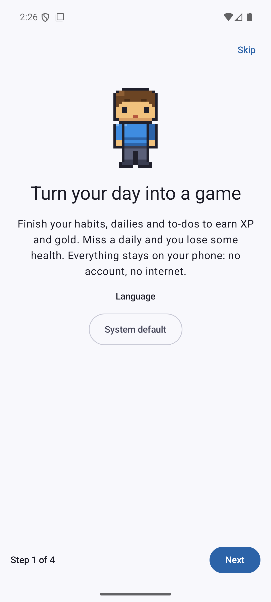
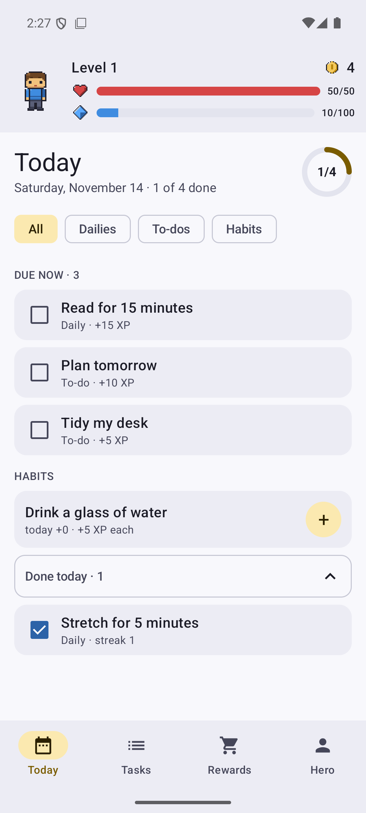
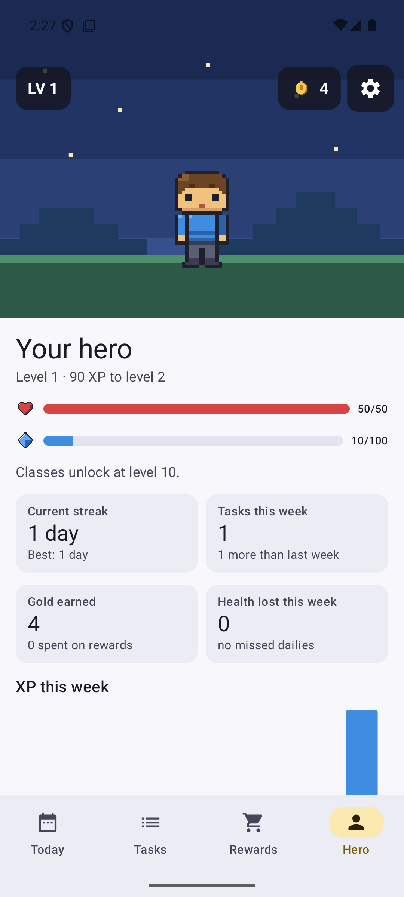
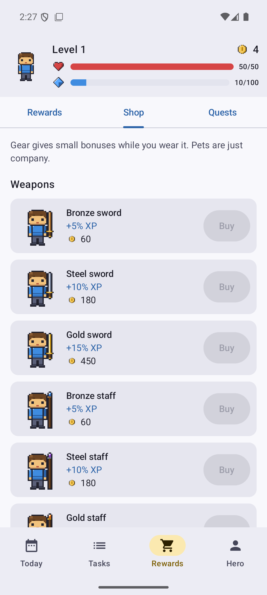
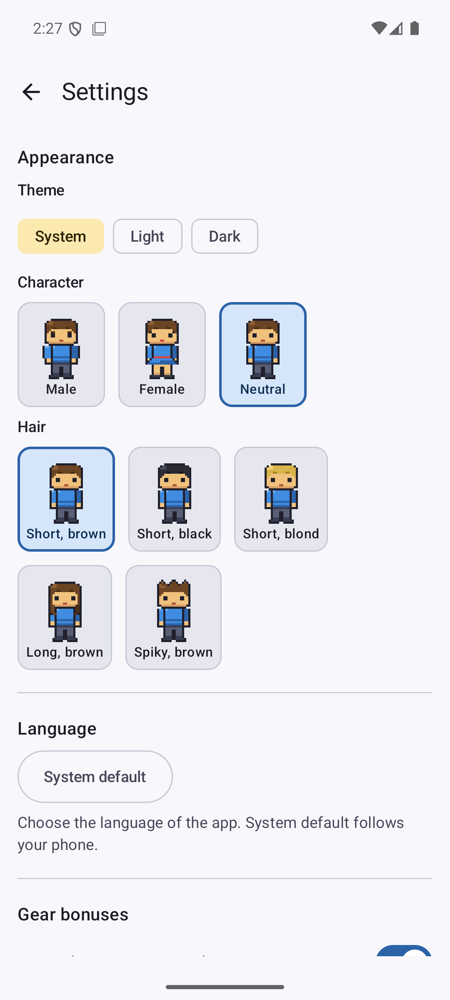

# Hearthbound

A native Android app that turns habits, dailies and to-dos into a single-player RPG. Finishing tasks earns XP and
gold, missed dailies cost health. It is **fully offline**: no account, no server, no `INTERNET` permission.

Kotlin, Jetpack Compose (Material 3), Room, DataStore, WorkManager and Hilt.

## Screenshots

<p>
  
  
  
  
  
</p>

## What you need

Docker and an Android phone (or emulator). Nothing else: the JDK, Gradle and the Android SDK live in the image.

## Everyday commands

```bash
docker compose build                                                  # once, and after Dockerfile changes
docker compose run --rm dev ./gradlew :core:domain:test testDebugUnitTest lint   # the standard check
docker compose run --rm dev ./gradlew assembleDebug                   # app/build/outputs/apk/debug/
docker compose run --rm dev ./gradlew installDebug                    # to a connected phone or emulator
docker compose run --rm dev adb devices                               # adb runs in the container
docker compose run --rm dev python3 -I tools/sprites.py               # redraw sprites and the contact sheet
```

The Gradle cache is the Docker volume `brain-training-androind_gradle-cache`, declared `external` in
`docker-compose.yml` so this project and the brain-training app share downloads. If you do not have that volume,
change `name:` to anything (compose then creates it) or run `docker volume create <name>`.

### Installing on a phone

Turn on Wireless debugging on the phone, then `docker compose run --rm dev adb connect <ip>:<port>` and
`installDebug`. The container uses host networking, so it can also reach an emulator running on the host.

The `Makefile` wraps these: `make help` lists the shortcuts (`check`, `test`, `lint`, `sprites`, `debug`, `install`,
`release`, `adb-devices`, `clean`, `shell`, `image`). CI runs the same targets with `RUN=` (no Docker wrapper).

## App parameters

The name, id and About link are build parameters. Precedence: `-P` Gradle property, then environment variable, then
the tracked `app.properties`, then the default.

| Parameter | `app.properties` | Default |
|---|---|---|
| `APP_NAME` | `Hearthbound` | `Hearthbound` |
| `APP_ID` | `io.github.desvelao.hearthbound` | `io.github.desvelao.hearthbound` |
| `APP_ABOUT_URL` | `https://github.com/Desvelao/hearthbound` (Settings > About; blank hides it) | `https://example.com` |
| `APP_VERSION_NAME` / `APP_VERSION_CODE` | not set (release workflow) | `0.1.0` / `1` |

```bash
APP_NAME="My App" APP_ID=com.example.myapp docker compose run --rm dev ./gradlew assembleDebug
```

## Release signing

Create a keystore inside the container (kept out of git) and `keystore.properties`:

```bash
docker compose run --rm dev bash -c '
  PW=$(head -c 24 /dev/urandom | base64 | tr -dc A-Za-z0-9 | head -c 24)
  keytool -genkeypair -keystore release.jks -alias release -keyalg RSA -keysize 4096 -validity 10000 \
    -dname "CN=Release" -storepass "$PW" -keypass "$PW"
  printf "storeFile=release.jks\nstorePassword=%s\nkeyAlias=release\nkeyPassword=%s\n" "$PW" "$PW" > keystore.properties'
```

Or pass `SIGNING_KEYSTORE`, `SIGNING_STORE_PASSWORD`, `SIGNING_KEY_ALIAS`, `SIGNING_KEY_PASSWORD` as
environment variables. A release build without signing details fails on purpose. Then `make release`. Back up the
keystore: losing it means you cannot update an installed app.

Outputs: `app/build/outputs/bundle/release/app-release.aab`, `app/build/outputs/apk/release/app-release.apk`,
and the R8 mapping in `app/build/outputs/mapping/release/mapping.txt`.

## Releases

`.github/workflows/release.yml` checks the art, tests, signs and builds the app on GitHub and publishes a GitHub
Release. (`ci.yml` is the plain push and pull-request check.)

1. Add repository secrets: `SIGNING_KEYSTORE_BASE64` (`base64 -w0 release.jks`), `SIGNING_STORE_PASSWORD`,
   `SIGNING_KEY_ALIAS`, `SIGNING_KEY_PASSWORD`.
2. Move the `Unreleased` entries in `CHANGELOG.md` under a new `## [x.y.z] - date` heading (a pre-release such
   as `1.2.3-rc.1` can use its own heading or the `1.2.3` one).
3. Tag and push: `git tag v1.2.3 && git push origin v1.2.3`. Pre-release tags (`v1.2.3-rc.1`, `-beta.N`,
   `-alpha.N`) create a GitHub pre-release.

Versions: release tags use `versionCode = major*10000 + minor*100 + patch` and `versionName` `1.2.3+<sha>`.
Because an rc/beta/alpha and its final share a code, Android will not update one to the other; uninstall first.
Other runs (manual `workflow_dispatch`) use `github.run_number` as code and `<version>-dev+<sha>` as name, and
only upload the files as a workflow artifact.

## Download and verify

Releases are published on the repository's Releases page (the link is in Settings > About). Each release has the
APK (to install), the AAB, the R8 mapping file and a `SHA256SUMS` file with the SHA-256 of all of them.

```bash
# Download the checksums, then the APK they list (the APK name ends with the commit hash):
BASE=https://github.com/Desvelao/hearthbound/releases/download/v0.1.0
curl -fLO "$BASE/SHA256SUMS"
APK=$(awk '/\.apk$/ {print $2}' SHA256SUMS)
curl -fLO "$BASE/$APK"          # or: wget "$BASE/$APK"

# 1. Check the file was not corrupted or replaced:
sha256sum --check --ignore-missing SHA256SUMS      # prints "<file>.apk: OK"

# 2. Check who signed it (apksigner is in the Android SDK build-tools, or `docker compose run --rm dev`):
apksigner verify --print-certs "$APK" | grep 'SHA-256 digest'
```

The release signing certificate's SHA-256 is
`7ee3040057d104d70854d9bcd864751b67248cc66e9c4571a5541d0fbad799ed`; the digest printed in step 2 must match it.
Step 1 only proves the APK matches `SHA256SUMS` from the same release, so an attacker who can replace release
files can replace both; step 2 is what proves the APK was signed with the project's key. Android also refuses to
update an installed app with an APK signed by a different key. Uninstall a debug build before installing a release
build, because their signatures differ.

To install the APK, copy it to the phone and open it (allow "Install unknown apps" for your file manager or
browser when asked), or with a device or emulator connected: `adb install -r "$APK"`.

## Backup

Settings > Backup saves one JSON file (`habit-rpg-backup-YYYY-MM-DD.json`) and restores it, on this phone or
another. Restoring replaces everything, and a file that is damaged or from a newer app version is refused without
changing anything. The format is versioned (`version` in the file); `BackupTest` pins it with fixed v1 and v2 files.
Android's own cloud and device-transfer backup are switched off on purpose.

## Game rules

All numbers are in `core/domain/.../Constants.kt`. XP and gold scale with difficulty, dailies earn a streak bonus,
missed dailies and minus taps cost health, reaching zero health costs a level and half the gold. The day starts at a
user-set hour. A break of more than two days, or pause mode, deals no damage.

## Equipment, pets and the widget

Gold also buys gear (a weapon, armour and headgear in three tiers) and pets in the **Shop**, under the Rewards tab.
Gear shows on the hero and gives small bonuses (weapon more XP, headgear more gold, armour less damage); **Settings >
Gear bonuses** turns the bonuses off so gear is only for show. Habits and to-dos also have a *value*: a habit you tap a
lot pays less, a neglected one or an old to-do pays more (between half and one and a half times). The **Today's
dailies** widget lists today's dailies with a tick box each; add it from the launcher's widget picker.

**Languages:** English, Spanish, German, French and Italian. The app follows the phone's language by default; **Settings >
Language** (and the first onboarding page) lets you pick another one, and it changes at once. Gear, boss and class names,
reminders and the widget follow it too. The translations were written without a native-speaker review, so wording fixes are
welcome: every word is in the `strings.xml` files under `values-es`, `values-de`, `values-fr` and `values-it` in each module.

**Quests** (Rewards > Quests) are timed bosses: pick one, and every plus tap, ticked daily and finished to-do hurts it. Beat it
before its last day or it escapes (no penalty; pause and long breaks never cost you a boss). From level 10 the **Hero** page
lets you pick a class (Warrior, Mage or Healer), spend a stat point per level and cast skills with mana. Each of these
extras, and the gear bonuses, has a switch: the third of the four onboarding steps ("Choose your game") sets them before
you start, and **Settings** changes them any time. Skipping onboarding leaves them all on. Off means the rules do nothing
and your progress is kept.

## Still manual

Play internal testing, checking that a backup restores on a second phone, and trying the widget on a real launcher.
Accounts, sync and parties are not built. The boss sprites are simple first drafts (the Frost Wyrm
most of all) and worth a pass in a pixel editor.
